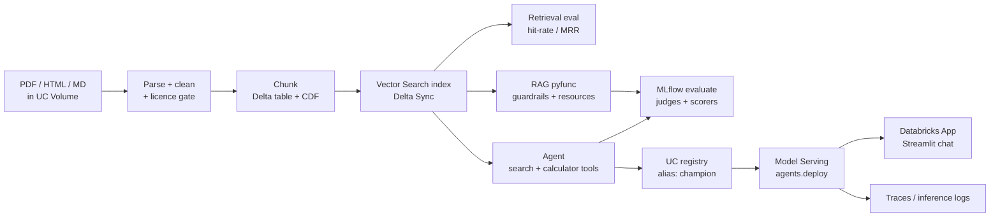

# Nimbus Support Agent — a hands-on Databricks GenAI lab

Build one agent end to end on **Databricks Free Edition**: raw files → chunks → vector index → measured retrieval → RAG model → tool-calling agent → evaluation → deployed endpoint → web app.

You already know the concepts (certified). This lab makes you *do* them, in order, with a checkpoint after every stage.



## The path (≈ 6–8 hours total, do one stage per sitting)

| Stage | Notebook | You build | Time |
|---|---|---|---|
| 0 | `00_setup` | Schema, Volume, data, model check | 30 m |
| 1 | `01_prompting_and_models` | Prompts, structured output, model comparison | 45 m |
| 2 | `02_ingest_and_chunk` | Clean, licence-gate, chunk → Delta | 60 m |
| 3 | `03_vector_search` | Endpoint, index, ANN/hybrid/filter/rerank | 60 m |
| 4 | `04_retrieval_eval` | Metrics; pick chunking with evidence | 45 m |
| 5 | `05_rag_pyfunc_register` | Guarded RAG model → Unity Catalog | 60 m |
| 6 | `06_agent_with_tools` | Tool-calling agent, traces, prompt registry | 75 m |
| 7 | `07_evaluate` | Judges + custom scorers | 60 m |
| 8 | `08_deploy_and_monitor` | Serving endpoint, `ai_query`, monitoring | 60 m |
| 9 | `09_app_ui` | Databricks App | 45 m |

Then `docs/extensions.md` (Genie, MCP, Lakebase memory, Agent Bricks, CI/CD) and the exercises at the end of `docs/LAB_GUIDE.md`.

## How to start
1. Create a Free Edition workspace (databricks.com/learn/free-edition).
2. Put this folder in a GitHub repo, then **Workspace → Create → Git folder** (or import the zip).
3. Open `notebooks/00_setup.py`, attach **Serverless**, run top to bottom. Follow `docs/LAB_GUIDE.md` for the coaching notes between stages.

## Layout
```
notebooks/   10 guided stages (Databricks source format)
src/lab/     reusable code: chunking, cleaning, guardrails, metrics, rag_model, agent, scorers
data/        fictional "Nimbus Cloud" docs (md/html/pdf), licence table, 16-question golden set
apps/        Streamlit chat app for Databricks Apps
tests/       pytest unit tests (run locally / in CI)
databricks.yml + .github/   bundle + CI example (Stage 10 / extensions)
docs/        LAB_GUIDE, exam-map, extensions, free-edition-notes
```

## Honest caveats
- Written against current SDKs (`mlflow` 3.x, `databricks-ai-search`, `databricks-agents`) but **not run on a live workspace** by its author. Expect to fix a name or two (model endpoint names change often). Each notebook lists common errors; `docs/free-edition-notes.md` lists what Free Edition blocks.
- Free Edition quotas: when exceeded, compute pauses for the day. Delete serving endpoints and stop apps when finished.
- Sources: [Exam guide (Mar 2026)](https://www.databricks.com/sites/default/files/2026-03/Databricks-Certified-Generative-AI-Engineer-Associate-Exam-Guide-Mar26.pdf), [Free Edition limitations](https://docs.databricks.com/aws/en/getting-started/free-edition-limitations).

Run local tests: `pip install -r requirements-dev.txt && pytest -q`
